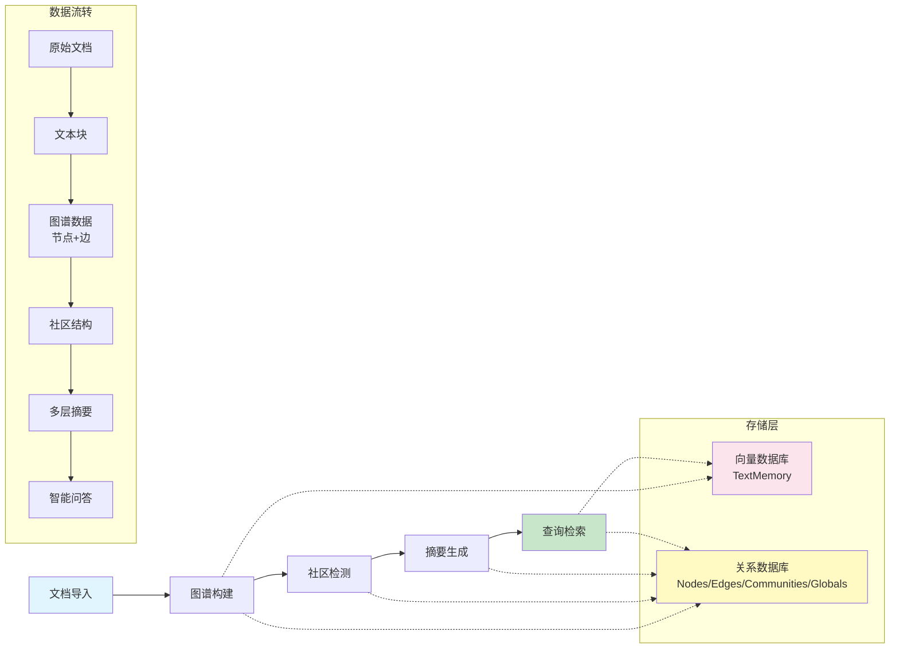
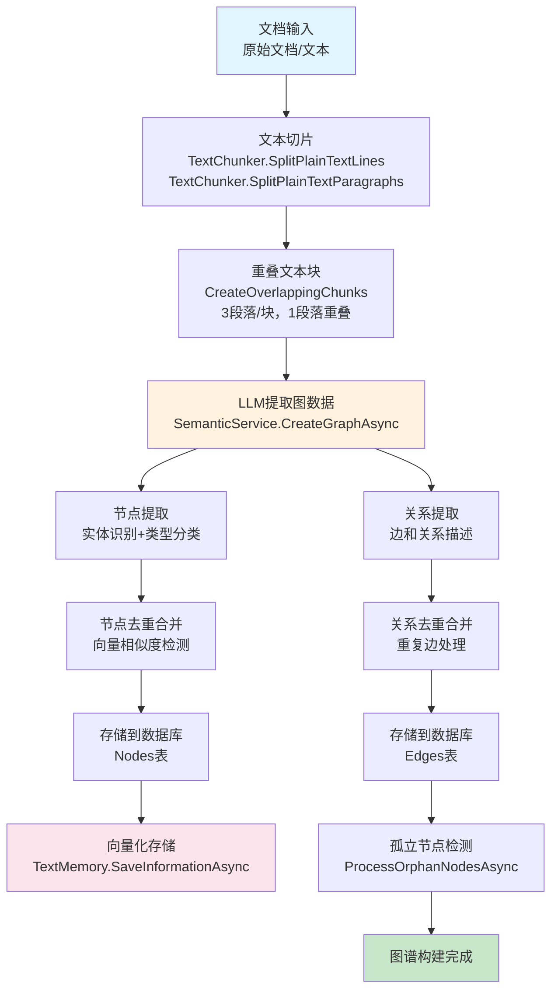
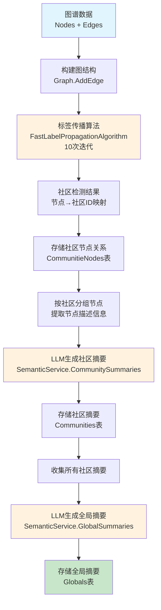
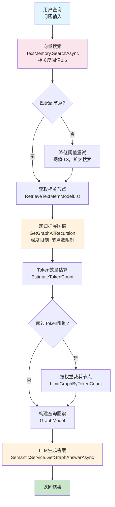
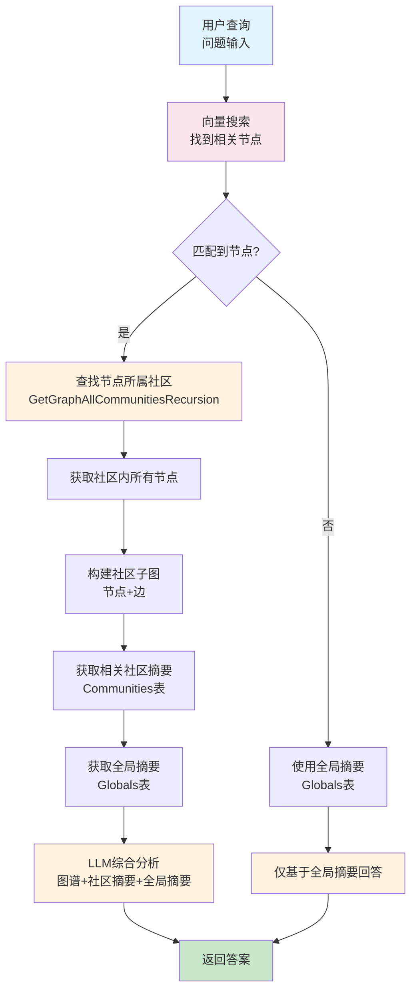

简体中文 | [English](./README.en.md) 

## 这是一个参考GraphRag的dotnet简易实现

基于微软在论文中提到的实现思路，执行过程GraphRAG主要实现了如下功能：
- Source Documents → Text Chunks：将源文档分割成文本块。
- Text Chunks → Element Instances：从每个文本块中提取图节点和边的实例。
- Element Instances → Element Summaries：为每个图元素生成摘要。
- Element Summaries → Graph Communities：使用社区检测算法将图划分为社区。
- Graph Communities → Community Summaries：为每个社区生成摘要。
- Community Summaries → Community Answers → Global Answer：使用社区摘要生成局部答案，然后汇总这些局部答案以生成全局答案。

本项目为demo示例，仅用于学习GraphRAG思路。

## 功能迭代路线图（对齐 microsoft/graphrag）

本项目定位是「.NET 简化实现」。经过两轮迭代，已把参考实现中**决定效果的核心检索闭环**补齐；
仍需重型基础设施的部分（精确 Leiden / FastGraphRAG NLP / CLI 工作流）继续按简化方式实现或暂缓。

### 能力矩阵（当前状态）

| 参考 GraphRAG 能力 | 状态 | 实现方式 |
| --- | --- | --- |
| TextUnit + 实体溯源 | ✅ | `TextUnits` 表 + `Nodes.TextUnitIds` + 独立向量集合 |
| Basic Search | ✅ | `SearchBasicAsync`，带 `[Data: Sources]` 引用 |
| 结构化社区报告 | ✅ | `title / summary / rating / rating_explanation / findings` |
| Global Search（Map-Reduce） | ✅ | 动态社区选择 → map 打分 → 排序裁剪 → reduce |
| Local Search 混合上下文 | ✅ | `ILocalSearchService`：entities/relationships/text units/reports/claims/历史按预算融合 |
| Question Generation | ✅ | 基于社区报告 + 历史问题生成候选追问 |
| 分层社区（levels/parent/children） | ✅ | `ICommunityHierarchyService`：折叠超节点 + 加权 LPA 递归；无跨社区边时生成覆盖全图的顶层 |
| 图统计信号（degree/weight/frequency/rank） | ✅ | `IGraphStatsService`，用于 Local/Global 排序与裁剪 |
| 动态社区选择（LLM 评分） | ✅ | `IDynamicCommunitySelectionService`：keep_parent / num_repeats / max_level 回退 |
| DRIFT Search | ✅ | `IDriftSearchService`：Primer → Follow-up(Local Search) → 层级 reduce |
| Claims / Covariates | ✅ | `Claims` 表 + `extract_claims` 提示词，默认关闭，可按需开启 |
| 增量索引 | ✅ | `IncrementalIndexAsync`：内容哈希变更检测，跳过未变块、清理失效块、重建社区 |
| 自动提示词调优 | ✅ | `AutoTunePromptsAsync` → `PromptOverrides` 运行时生效 |
| 精确 Hierarchical Leiden | ⚠️ 近似 | 用确定性加权 LPA 递归近似，无外部图算法库依赖 |
| 精确 tokenizer（tiktoken） | ⚠️ 近似 | 字符/汉字加权估算 |
| CLI / 多输入格式 / 多向量后端 / LLM 缓存限流 / 评估基准 | ⏸ 暂缓 | 平台化能力，与简化库定位冲突 |

### 第二轮落地：P0 + P1

- **P0-1 分层社区**：`Communities` 新增 `Level / Parent / Children / CommunityRank`，
  `CommunitieNodes` 新增 `Level`；每层一份结构化报告（上层由子报告汇总）。
  `GlobalCommunityLevel` 可指定检索层级；既有社区检索固定沿 level 0，语义不回归。
- **P0-2 Local Search 混合上下文**：按 `LocalTextUnitProp / LocalCommunityProp` 分配预算，
  融合 6 类候选集并用 degree/weight/rank 排序裁剪。
- **P0-3 图统计**：导入与社区重建时维护 `Nodes.Degree/Frequency`、`Edges.Weight/TextUnitIds`、
  `Communities.CommunityRank`；`GetIndexStats` 可观测。
- **P1** DRIFT Search、Claims 抽取、完整动态社区选择、增量索引、自动提示词调优，见上表。

> 新增能力分布在 `IGraphSearchService`、`ILocalSearchService`、`IDriftSearchService`、
> `IGraphIndexService`、`ICommunityHierarchyService`、`IDynamicCommunitySelectionService`、
> `IGraphStatsService`，与既有 `IGraphService` 解耦，不破坏已有调用方。

### 回归测试

仓库内置零外部框架依赖的离线回归测试（57 项检查），覆盖既有能力防退化 + 全部 P0/P1 新能力 +
旧库 schema 迁移 + LLM 非法输出容错：

```
dotnet run --project tests/GraphRag.Net.Regression -f net9.0
```

通过注入脚本化 `StreamFn` 与确定性哈希向量（`VectorMemoryProvider.SetFactory`），
全程无需任何 API Key，结果可重复。

## 核心业务流程

### 1. 整体架构流程



### 2. 文档导入与图谱构建流程



### 3. 社区检测与摘要生成流程



### 4. 直接图谱查询流程



### 5. 社区算法查询流程



### 核心算法说明

1. **文本切片算法**：使用重叠窗口技术，每个文本块包含3个段落，相邻块之间重叠1个段落，确保关系信息的连续性。

2. **社区检测算法**：采用快速标签传播算法（Fast Label Propagation Algorithm），通过10次迭代来发现图中的社区结构。

3. **向量搜索策略**：首先使用0.5的相关度阈值进行搜索，如果结果不足则降低至0.3重试，确保找到足够的相关节点。

4. **Token优化机制**：实时估算token使用量，当超过限制时按节点权重进行智能裁剪，保证LLM输入的有效性。

5. **孤立节点处理**：自动检测没有关系连接的孤立节点，通过语义搜索尝试为其建立与其他节点的关系。

## 您可以直接在项目中引用NuGet包，或者直接使用本项目提供API服务

出于方便，LLM接口目前只兼容了openai的规范，其他大模型可以考虑使用one-api类的集成产品

在appsettings.json配置

```
 "GraphOpenAI": {
   "Key": "sk-xxx",
   "EndPoint": "https://api.antsk.cn/",
   "ChatModel": "gpt-4o-mini",
   "EmbeddingModel": "text-embedding-ada-002"
 },
"TextChunker": {
    "LinesToken": 100,
    "ParagraphsToken": 1000
},
"GraphDBConnection": {
    "DbType": "Sqlite", //PostgreSQL
    "DBConnection": "Data Source=graph.db",
    "VectorConnection": "graphmem.db", //如果用PostgreSQL，可以和DBConnection一致
    "VectorSize": 1536 //DbType=PostgreSQL时需要设置，sqlite可以不设置
},
"GraphSearch": {
    "SearchMinRelevance": 0.5, //搜索最小相关性
    "SearchLimit": 3, //向量搜索节点限制个数
    "NodeDepth": 3 ,//检索节点深度
    "MaxNodes": 100 //检索最大节点数
},
"GraphQuery": {
    "BasicSearchTopK": 5, //基础检索取回的文本单元数量
    "BasicSearchMinRelevance": 0.3, //基础检索最小相关度，结果为空自动降阈值重试
    "DynamicCommunitySelection": true, //是否按问题语义动态挑选社区报告
    "MaxCommunityReports": 20, //参与全局检索的社区报告上限
    "MapBatchTokens": 6000, //map 阶段单批次 token 预算
    "MapMaxLength": 800, //map 阶段单批次答案字数上限
    "ReduceMaxLength": 1200, //reduce 阶段答案字数上限
    "MaxReduceTokens": 12000, //reduce 阶段输入 token 预算
    "MinPointScore": 1, //关键点最低重要性评分（0-100）
    "ConcurrentCoroutines": 4, //map 阶段并发批次数量
    "QuestionCount": 5, //候选追问数量
    "MaxReportFindings": 8, //单个社区报告最多保留的关键发现条数
    "ResponseType": "多段落、结构清晰的中文回答", //回答长度与格式
    "CommunityMaxLevels": 3, //分层社区最大层级数
    "CommunityMinSize": 1, //层级递归停止阈值
    "GlobalCommunityLevel": -1, //全局检索使用的层级，-1 为自动（全部）
    "EnableGraphStats": true, //维护 degree/frequency/weight/rank
    "LocalTextUnitProp": 0.5, //Local 上下文预算中原文占比
    "LocalCommunityProp": 0.2, //Local 上下文预算中社区报告占比
    "LocalMaxContextTokens": 12000, //Local 上下文 token 预算
    "LocalTopKEntities": 10,
    "LocalTopKRelationships": 10,
    "LocalMaxConversationTurns": 5,
    "EnableClaimExtraction": false, //导入/增量索引时是否自动抽取 claims
    "ClaimMaxPerTextUnit": 10,
    "DynamicSelectionMode": "llm", //off / vector / llm（完整实现）
    "DynamicSearchThreshold": 50, //LLM 评分入选阈值 0-100
    "DynamicKeepParent": true, //子社区相关时保留父社区
    "DynamicNumRepeats": 1, //重复评分取最高分
    "DynamicMaxLevel": -1, //层级回退上限，-1 不限制
    "DriftKFollowups": 3, //每阶段后续问题数
    "DriftPrimerFolds": 2, //Primer 折数
    "DriftNDepth": 2, //递归深度
    "DriftConcurrency": 3,
    "IncrementalEnabled": true, //内容哈希变更检测
    "PromptTuneSampleSize": 5,
    "PromptTuneEntityTypes": 8
},
"GraphSys": {
    "RetryCounnt": 2 //重试次数，使用国产模型可能会出现json提取失败，增加重试次数可提高可用性
}
```
## 启动项目
Web 项目多目标 net9.0 / net10.0 / net11.0，运行时需指定框架：
```
dotnet run --project GraphRag.Net.Web.csproj -f net9.0
```
改用 .NET 11 启动：
```
dotnet run --project GraphRag.Net.Web.csproj -f net11.0
```

## 启动项目后可以通过
```
http://localhost:5000/swagger
```
## 打开swagger查看接口


### 检索与索引接口（对齐 microsoft/graphrag）

| 接口 | 方法 | 说明 |
| --- | --- | --- |
| `/api/Graph/SearchBasic` | POST | 基础向量 RAG，可加 `?topK=5`；返回答案 + 可追溯 `sources` |
| `/api/Graph/SearchGlobal` | POST | Map-Reduce 全局检索，可加 `?responseType=...&dynamicSelection=true` |
| `/api/Graph/SearchLocal` | POST | Local 混合上下文检索；body 支持 `history` 对话历史 |
| `/api/Graph/SearchDrift` | POST | DRIFT 三阶段检索；返回答案 + 层级问答树 + 局部检索次数 |
| `/api/Graph/GenerateQuestions` | POST | 候选追问生成 |
| `/api/Graph/GetTextUnits` | GET | `?index=`，列出原始文本单元（溯源） |
| `/api/Graph/GetCommunityReports` | GET | `?index=`，列出结构化社区报告 |
| `/api/Graph/GetClaims` | GET | `?index=`，列出 claims |
| `/api/Graph/ExtractClaims` | POST | `{ "index", "force" }`，抽取 claims |
| `/api/Graph/IncrementalIndex` | POST | `{ "index", "input", "documentId" }`，按内容哈希增量导入 |
| `/api/Graph/AutoTunePrompts` | POST | `{ "index", "domain" }`，自动提示词调优 |
| `/api/Graph/GetPromptOverrides` | GET | 查看当前生效的提示词覆盖 |
| `/api/Graph/ClearPromptOverrides` | GET | 清除覆盖，恢复磁盘提示词 |
| `/api/Graph/GetIndexStats` | GET | `?index=`，节点/边/文本单元/社区层级/claims/度数/权重统计 |
| `/api/Graph/GetCommunityLevels` | GET | `?index=`，分层社区各层级统计 |

服务层：`IGraphSearchService`（Basic / Global / QuestionGen）、`ILocalSearchService`（Local）、
`IDriftSearchService`（DRIFT）、`IGraphIndexService`（Claims / 增量索引 / Prompt Tune / 统计）、
`ICommunityHierarchyService`（分层社区）、`IDynamicCommunitySelectionService`（动态选择）。
流式版本：`SearchBasicStreamAsync` / `SearchGlobalStreamAsync` / `SearchLocalStreamAsync` /
`SearchDriftStreamAsync` / `SearchGraphStreamAsync` 等。

> **升级说明**：本轮新增 `Claims` / `TextUnits` 表与多个字段，CodeFirst 会自动为既有数据库加列。
> 升级后建议对已有索引重新调用一次 `GraphCommunities` 与 `GraphGlobal`，
> 以生成分层社区报告、图统计信号与社区向量。

### 也可以使用界面
```
http://localhost:5000/
```

打开blazor的UI界面，页面提供了文本导入、文件导入，和问答对话，查看知识图谱等功能


## Nuget包使用
```
dotnet add package GraphRag.Net
```
## 为了方便进行提示词调整与修改，SK Plugin我们剥离出了项目，您需要把GraphRag.Net.Web项目中的 graphPlugins目录拷贝到你的项目中，并设置：
[graphPlugins](https://github.com/AIDotNet/GraphRag.Net/tree/main/src/GraphRag.Net.Web/graphPlugins)
```
  <ItemGroup>
    <None Include="graphPlugins\**">
      <CopyToOutputDirectory>PreserveNewest</CopyToOutputDirectory>
    </None>
  </ItemGroup>
```

### 默认配置，使用OpenAI标准接口，在配置了OpenAI的appsettings后可以使用下面代码进行注入
添加包以后，需要进行配置文件的设置以及依赖注入
```
//OpenAI配置
builder.Configuration.GetSection("GraphOpenAI").Get<GraphOpenAIOption>();
//文档切片配置
builder.Configuration.GetSection("TextChunker").Get<TextChunkerOption>();
//配置数据库链接
builder.Configuration.GetSection("GraphDBConnection").Get<GraphDBConnectionOption>();
//系统设置
builder.Configuration.GetSection("GraphSys").Get<GraphSysOption>();

//注入AddGraphRagNet,注意，需要先注入配置文件，然后再注入GraphRagNet
builder.Services.AddGraphRagNet();
```

### 如果你想接入其他模型，可以参考以下代码,这里抽象了Kernel的实现，你可以自定义实现
```
var kernelBuild = Kernel.CreateBuilder();
kernelBuild.Services.AddKeyedSingleton<ITextGenerationService>("mock-text", new MockTextCompletion());
kernelBuild.Services.AddKeyedSingleton<IChatCompletionService>("mock-chat", new MockChatCompletion());
kernelBuild.Services.AddSingleton((ITextEmbeddingGenerationService)new MockTextEmbeddingGeneratorService());
kernelBuild.Services.AddKeyedSingleton("mock-embedding", new MockTextEmbeddingGeneratorService());

builder.Services.AddGraphRagNet(kernelBuild.Build());
```

#### 此处需要注意，由于导入可能分多次导入，没有在导入时自动调用生成社区和全局信息，需要自己根据实际情况调用生成社区和全局信息

```
    await _graphService.GraphCommunitiesAsync(index);
    await _graphService.GraphGlobalAsync(index);
```


使用时注入 IGraphService  服务,以下为参考示例代码
```
namespace GraphRag.Net.Api.Controllers
{
    [Route("api/[controller]/[action]")]
    [ApiController]
    public class GraphController(IGraphService _graphService) : ControllerBase
    {
        /// <summary>
        /// 获取所有的索引数据
        /// </summary>
        /// <returns></returns>
        [HttpGet]
        public async Task<IActionResult> GetAllIndex()
        {
            var graphModel = _graphService.GetAllIndex();
            return Ok(graphModel);
        }


        /// <summary>
        /// 获取所有的图谱数据
        /// </summary>
        /// <param name="index"></param>
        /// <returns></returns>
        [HttpGet]
        public async Task<IActionResult> GetAllGraphs(string index)
        {
            if (string.IsNullOrEmpty(index))
            {
                return Ok(new GraphViewModel());
            }
            var graphModel = _graphService.GetAllGraphs(index);
            return Ok(graphModel);
        }


        /// <summary>
        /// 插入文本数据
        /// </summary>
        /// <param name="model"></param>
        /// <returns></returns>
        [HttpPost]
        public async Task<IActionResult> InsertGraphData(InputModel model)
        {
            await _graphService.InsertGraphDataAsync(model.Index, model.Input);
            return Ok();
        }

        /// <summary>
        /// 搜索递归获取节点相关的所有边和节点进行图谱对话
        /// </summary>
        /// <param name="model"></param>
        /// <returns></returns>
        [HttpPost]
        public async Task<IActionResult> SearchGraph(InputModel model)
        {
            var result = await _graphService.SearchGraphAsync(model.Index, model.Input);
            return Ok(result);
        }

        /// <summary>
        /// 通过社区算法检索社区节点进行对话
        /// </summary>
        /// <param name="model"></param>
        /// <returns></returns>
        [HttpPost]
        public async Task<IActionResult> SearchGraphCommunity(InputModel model)
        {
            var result = await _graphService.SearchGraphCommunityAsync(model.Index, model.Input);
            return Ok(result);
        }

        /// <summary>
        /// 导入txt文档
        /// </summary>
        /// <param name="index"></param>
        /// <param name="file"></param>
        /// <returns></returns>
        [HttpPost]
        public async Task<IActionResult> ImportTxt(string index,IFormFile file)
        {
            var forms = await Request.ReadFormAsync();
            using (var stream = new StreamReader(file.OpenReadStream()))
            {
                var txt = await stream.ReadToEndAsync();
                await _graphService.InsertTextChunkAsync(index,txt);
                return Ok();
            }
        }

        /// <summary>
        /// 通过社区检测生成社区和摘要
        /// </summary>
        /// <param name="index"></param>
        /// <returns></returns>
        [HttpGet]
        public async Task<IActionResult> GraphCommunities(string index)
        {
            await _graphService.GraphCommunitiesAsync(index);
            return Ok();
        }      
        
        /// <summary>
        /// 通过社区摘要生成全局摘要
        /// </summary>
        /// <param name="index"></param>
        /// <returns></returns>
        [HttpGet]
        public async Task<IActionResult> GraphGlobal(string index)
        {
            await _graphService.GraphGlobalAsync(index);
            return Ok();
        }

        /// <summary>
        /// 删除图谱数据
        /// </summary>
        /// <param name="index"></param>
        /// <returns></returns>
        [HttpGet]
        public async Task<IActionResult> DeleteGraph(string index)
        {
            await _graphService.DeleteGraph(index);
            return Ok();
        }
    }

    public class InputModel
    {
        public string Index { get; set; }
        public string Input { get; set; }
    }
}

```

## 测试DB，有社区朋友提前预训练了一些数据，链接如下，下载后直接放进项目目录替换即可测试体验
```
https://pan.quark.cn/s/bf2d21f29f85
```

## 更多Rag场景可查看 AntSK
项目地址：[AntSK](https://github.com/AIDotNet/AntSK)

体验环境：

[Demo地址](https://demo.antsk.cn)

账号：test

密码：test

