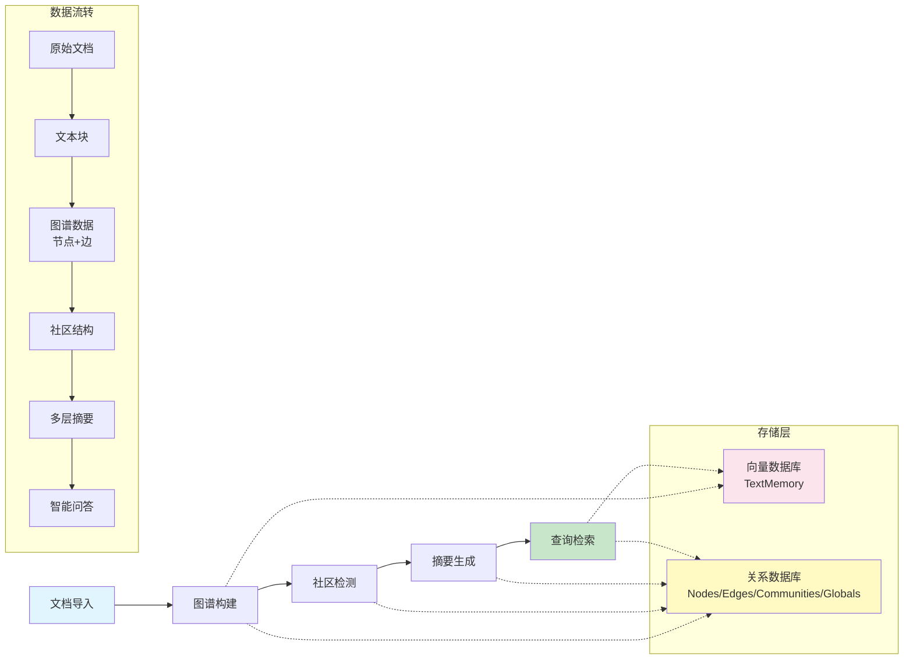
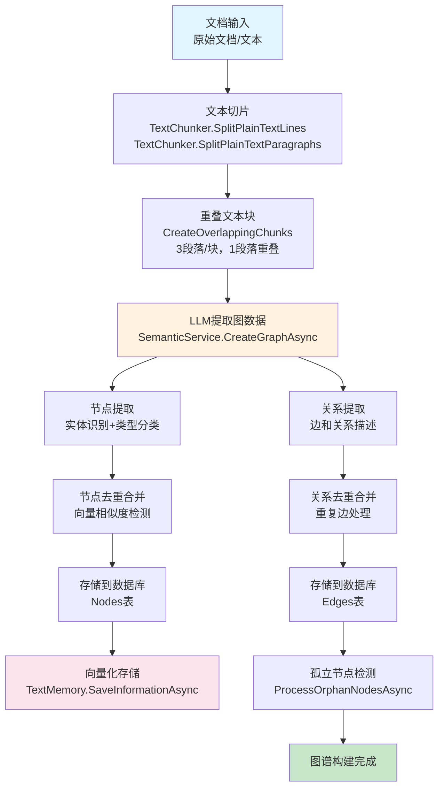
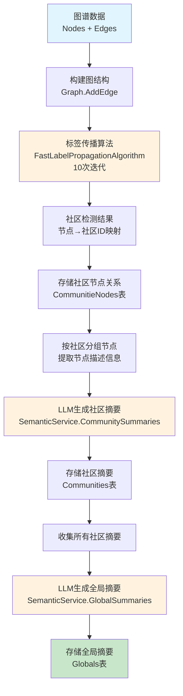
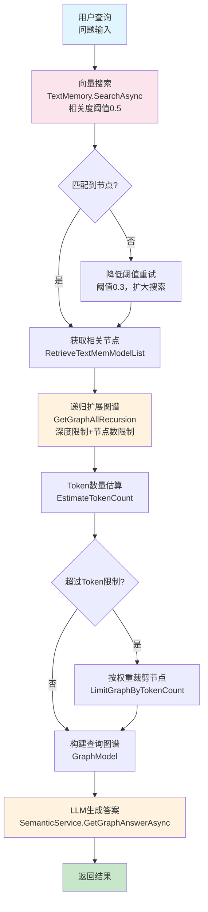
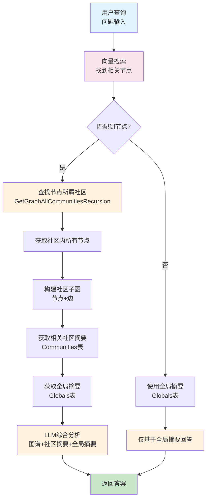

简体中文 | [English](./README.en.md) 

## 这是一个参考GraphRag的dotnet简易实现

基于微软在论文中提到的实现思路，执行过程GraphRAG主要实现了如下功能：
- Source Documents → Text Chunks：将源文档分割成文本块。
- Text Chunks → Element Instances：从每个文本块中提取图节点和边的实例。
- Element Instances → Element Summaries：为每个图元素生成摘要。
- Element Summaries → Graph Communities：使用社区检测算法将图划分为社区。
- Graph Communities → Community Summaries：为每个社区生成摘要。
- Community Summaries → Community Answers → Global Answer：使用社区摘要生成局部答案，然后汇总这些局部答案以生成全局答案。

本项目为demo示例，仅用于学习GraphRAG思路。

## 功能迭代路线图（对齐 microsoft/graphrag）

本项目定位是「.NET 简化实现」，迭代原则是：**优先补齐决定 GraphRAG 效果的检索闭环，
不照搬需要重型基础设施（分层 Leiden / NLP 抽取 / 增量索引 / CLI 提示词调优）的部分。**

### 能力差距分析与取舍

| 参考 GraphRAG 能力 | 迭代前 | 结论 | 取舍理由 |
| --- | --- | --- | --- |
| TextUnit + 实体溯源（text_unit_ids） | ❌ 仅存节点文本 | ✅ 本轮加入 | Basic Search、引用溯源、原文增强的共同地基；改动小、收益面广 |
| Basic Search（基础向量 RAG） | ❌ | ✅ 本轮加入 | 提供基线对照与图谱检索失败时的兜底，成本极低 |
| 结构化社区报告（title/rating/findings） | ⚠️ 仅纯文本摘要 | ✅ 本轮加入 | 全局检索 map-reduce 的输入质量完全取决于报告结构，必须先补 |
| Global Search（动态社区选择 + Map-Reduce） | ⚠️ 单次拼接全部摘要 | ✅ 本轮加入 | GraphRAG 最核心差异点；「把所有社区摘要塞进一个 prompt」在大索引下必然超限 |
| Question Generation（候选追问） | ❌ | ✅ 本轮加入 | 纯提示词能力，无基础设施依赖，直接提升对话体验 |
| 分层 Leiden 社区（levels/parent/children） | ⚠️ 单层标签传播 | ⏸ 暂缓 | 需引入层级聚类实现；已预留 `Communities.Level`，列为下一轮 |
| DRIFT Search | ❌ | ⏸ 暂缓 | primer → follow-up → 层级归并三阶段复杂度高，且收益依赖分层社区 |
| Claims / Covariates 抽取 | ❌ | ⏸ 暂缓 | 参考实现默认关闭且需提示词调优，面向特定风控领域，通用性低 |
| 自动提示词调优 / 增量索引 / FastGraphRAG(NLP) | ❌ | ⏸ 暂缓 | 依赖 CLI 工作流、文档快照与 Python NLP 栈，与「简化 .NET 库」定位冲突 |
| 实体度数 / 关系权重排序 | ❌ | ⏸ 暂缓 | 可作为 Local Search 上下文排序的后续优化，本轮先不引入 |

### 本轮落地的 5 项能力

1. **文本单元与溯源**：新增 `TextUnits` 表与独立向量集合。每次导入落盘原始文本块，
   节点通过 `TextUnitIds` 回溯来源；`DeleteGraph` 同步清理。对应参考实现 Phase 1 / Phase 6。
2. **结构化社区报告**：`GraphCommunitiesAsync` 现生成
   `title / summary / rating / rating_explanation / findings` 报告（新提示词 `community_report`），
   并把社区报告向量化用于动态选择；LLM 输出异常时自动回退既有纯文本摘要链路。
   `Communities` 表新增 `Title / FullContent / Findings / Rating / RatingExplanation / Size / Level` 字段。
3. **Global Search（Map-Reduce）**：动态社区选择（按问题语义召回最相关社区，失败回退影响力评分）→
   按 token 预算分批 → **map** 并发产出带 0-100 评分的关键点 → 过滤/排序/裁剪 →
   **reduce** 汇总为最终答案（保留 `[Data: Reports (...)]` 引用）。对应 `global_search.md`。
4. **Basic Search**：直接对原始文本单元做向量 RAG，返回答案 + 可追溯来源片段（`[Data: Sources (...)]`），
   可用作效果基线与兜底。提供单次与流式接口。
5. **Question Generation**：基于社区报告/全局摘要与历史问题生成候选追问，UI 可点击回填。

> 新增能力集中在 `IGraphSearchService`，与既有 `IGraphService` 解耦，不破坏已有调用方。

## 核心业务流程

### 1. 整体架构流程



### 2. 文档导入与图谱构建流程



### 3. 社区检测与摘要生成流程



### 4. 直接图谱查询流程



### 5. 社区算法查询流程



### 核心算法说明

1. **文本切片算法**：使用重叠窗口技术，每个文本块包含3个段落，相邻块之间重叠1个段落，确保关系信息的连续性。

2. **社区检测算法**：采用快速标签传播算法（Fast Label Propagation Algorithm），通过10次迭代来发现图中的社区结构。

3. **向量搜索策略**：首先使用0.5的相关度阈值进行搜索，如果结果不足则降低至0.3重试，确保找到足够的相关节点。

4. **Token优化机制**：实时估算token使用量，当超过限制时按节点权重进行智能裁剪，保证LLM输入的有效性。

5. **孤立节点处理**：自动检测没有关系连接的孤立节点，通过语义搜索尝试为其建立与其他节点的关系。

## 您可以直接在项目中引用NuGet包，或者直接使用本项目提供API服务

出于方便，LLM接口目前只兼容了openai的规范，其他大模型可以考虑使用one-api类的集成产品

在appsettings.json配置

```
 "GraphOpenAI": {
   "Key": "sk-xxx",
   "EndPoint": "https://api.antsk.cn/",
   "ChatModel": "gpt-4o-mini",
   "EmbeddingModel": "text-embedding-ada-002"
 },
"TextChunker": {
    "LinesToken": 100,
    "ParagraphsToken": 1000
},
"GraphDBConnection": {
    "DbType": "Sqlite", //PostgreSQL
    "DBConnection": "Data Source=graph.db",
    "VectorConnection": "graphmem.db", //如果用PostgreSQL，可以和DBConnection一致
    "VectorSize": 1536 //DbType=PostgreSQL时需要设置，sqlite可以不设置
},
"GraphSearch": {
    "SearchMinRelevance": 0.5, //搜索最小相关性
    "SearchLimit": 3, //向量搜索节点限制个数
    "NodeDepth": 3 ,//检索节点深度
    "MaxNodes": 100 //检索最大节点数
},
"GraphQuery": {
    "BasicSearchTopK": 5, //基础检索取回的文本单元数量
    "BasicSearchMinRelevance": 0.3, //基础检索最小相关度，结果为空自动降阈值重试
    "DynamicCommunitySelection": true, //是否按问题语义动态挑选社区报告
    "MaxCommunityReports": 20, //参与全局检索的社区报告上限
    "MapBatchTokens": 6000, //map 阶段单批次 token 预算
    "MapMaxLength": 800, //map 阶段单批次答案字数上限
    "ReduceMaxLength": 1200, //reduce 阶段答案字数上限
    "MaxReduceTokens": 12000, //reduce 阶段输入 token 预算
    "MinPointScore": 1, //关键点最低重要性评分（0-100）
    "ConcurrentCoroutines": 4, //map 阶段并发批次数量
    "QuestionCount": 5, //候选追问数量
    "MaxReportFindings": 8, //单个社区报告最多保留的关键发现条数
    "ResponseType": "多段落、结构清晰的中文回答" //回答长度与格式
},
"GraphSys": {
    "RetryCounnt": 2 //重试次数，使用国产模型可能会出现json提取失败，增加重试次数可提高可用性
}
```
## 启动项目
Web 项目多目标 net9.0 / net10.0 / net11.0，运行时需指定框架：
```
dotnet run --project GraphRag.Net.Web.csproj -f net9.0
```
改用 .NET 11 启动：
```
dotnet run --project GraphRag.Net.Web.csproj -f net11.0
```

## 启动项目后可以通过
```
http://localhost:5000/swagger
```
## 打开swagger查看接口


### 新增检索接口（对齐 microsoft/graphrag Query Engine）

| 接口 | 方法 | 说明 |
| --- | --- | --- |
| `/api/Graph/SearchBasic` | POST | 基础向量 RAG：`{ "index", "input" }`，可加 `?topK=5`。返回 `answer` + `sources`（可追溯文本单元） |
| `/api/Graph/SearchGlobal` | POST | Map-Reduce 全局检索，可加 `?responseType=...&dynamicSelection=true`。返回答案、带评分的关键点、选中社区 |
| `/api/Graph/GenerateQuestions` | POST | `{ "index", "history": ["历史问题"], "count": 5 }`，返回候选追问列表 |
| `/api/Graph/GetTextUnits` | GET | `?index=`，列出原始文本单元（溯源） |
| `/api/Graph/GetCommunityReports` | GET | `?index=`，列出结构化社区报告（title/rating/findings） |

服务层对应 `IGraphSearchService`（`SearchBasicAsync` / `SearchGlobalAsync` / `GenerateQuestionsAsync`，
以及 `SearchBasicStreamAsync` / `SearchGlobalStreamAsync` 流式版本）。

> **索引升级说明**：`GraphCommunitiesAsync` 现在生成结构化社区报告并把报告向量化。
> 对已有索引，升级后建议重新调用一次 `GraphCommunities` 与 `GraphGlobal`，
> 以获得新的报告字段与动态社区选择能力；数据库表会自动新增所需列（CodeFirst）。

### 也可以使用界面
```
http://localhost:5000/
```

打开blazor的UI界面，页面提供了文本导入、文件导入，和问答对话，查看知识图谱等功能


## Nuget包使用
```
dotnet add package GraphRag.Net
```
## 为了方便进行提示词调整与修改，SK Plugin我们剥离出了项目，您需要把GraphRag.Net.Web项目中的 graphPlugins目录拷贝到你的项目中，并设置：
[graphPlugins](https://github.com/AIDotNet/GraphRag.Net/tree/main/src/GraphRag.Net.Web/graphPlugins)
```
  <ItemGroup>
    <None Include="graphPlugins\**">
      <CopyToOutputDirectory>PreserveNewest</CopyToOutputDirectory>
    </None>
  </ItemGroup>
```

### 默认配置，使用OpenAI标准接口，在配置了OpenAI的appsettings后可以使用下面代码进行注入
添加包以后，需要进行配置文件的设置以及依赖注入
```
//OpenAI配置
builder.Configuration.GetSection("GraphOpenAI").Get<GraphOpenAIOption>();
//文档切片配置
builder.Configuration.GetSection("TextChunker").Get<TextChunkerOption>();
//配置数据库链接
builder.Configuration.GetSection("GraphDBConnection").Get<GraphDBConnectionOption>();
//系统设置
builder.Configuration.GetSection("GraphSys").Get<GraphSysOption>();

//注入AddGraphRagNet,注意，需要先注入配置文件，然后再注入GraphRagNet
builder.Services.AddGraphRagNet();
```

### 如果你想接入其他模型，可以参考以下代码,这里抽象了Kernel的实现，你可以自定义实现
```
var kernelBuild = Kernel.CreateBuilder();
kernelBuild.Services.AddKeyedSingleton<ITextGenerationService>("mock-text", new MockTextCompletion());
kernelBuild.Services.AddKeyedSingleton<IChatCompletionService>("mock-chat", new MockChatCompletion());
kernelBuild.Services.AddSingleton((ITextEmbeddingGenerationService)new MockTextEmbeddingGeneratorService());
kernelBuild.Services.AddKeyedSingleton("mock-embedding", new MockTextEmbeddingGeneratorService());

builder.Services.AddGraphRagNet(kernelBuild.Build());
```

#### 此处需要注意，由于导入可能分多次导入，没有在导入时自动调用生成社区和全局信息，需要自己根据实际情况调用生成社区和全局信息

```
    await _graphService.GraphCommunitiesAsync(index);
    await _graphService.GraphGlobalAsync(index);
```


使用时注入 IGraphService  服务,以下为参考示例代码
```
namespace GraphRag.Net.Api.Controllers
{
    [Route("api/[controller]/[action]")]
    [ApiController]
    public class GraphController(IGraphService _graphService) : ControllerBase
    {
        /// <summary>
        /// 获取所有的索引数据
        /// </summary>
        /// <returns></returns>
        [HttpGet]
        public async Task<IActionResult> GetAllIndex()
        {
            var graphModel = _graphService.GetAllIndex();
            return Ok(graphModel);
        }


        /// <summary>
        /// 获取所有的图谱数据
        /// </summary>
        /// <param name="index"></param>
        /// <returns></returns>
        [HttpGet]
        public async Task<IActionResult> GetAllGraphs(string index)
        {
            if (string.IsNullOrEmpty(index))
            {
                return Ok(new GraphViewModel());
            }
            var graphModel = _graphService.GetAllGraphs(index);
            return Ok(graphModel);
        }


        /// <summary>
        /// 插入文本数据
        /// </summary>
        /// <param name="model"></param>
        /// <returns></returns>
        [HttpPost]
        public async Task<IActionResult> InsertGraphData(InputModel model)
        {
            await _graphService.InsertGraphDataAsync(model.Index, model.Input);
            return Ok();
        }

        /// <summary>
        /// 搜索递归获取节点相关的所有边和节点进行图谱对话
        /// </summary>
        /// <param name="model"></param>
        /// <returns></returns>
        [HttpPost]
        public async Task<IActionResult> SearchGraph(InputModel model)
        {
            var result = await _graphService.SearchGraphAsync(model.Index, model.Input);
            return Ok(result);
        }

        /// <summary>
        /// 通过社区算法检索社区节点进行对话
        /// </summary>
        /// <param name="model"></param>
        /// <returns></returns>
        [HttpPost]
        public async Task<IActionResult> SearchGraphCommunity(InputModel model)
        {
            var result = await _graphService.SearchGraphCommunityAsync(model.Index, model.Input);
            return Ok(result);
        }

        /// <summary>
        /// 导入txt文档
        /// </summary>
        /// <param name="index"></param>
        /// <param name="file"></param>
        /// <returns></returns>
        [HttpPost]
        public async Task<IActionResult> ImportTxt(string index,IFormFile file)
        {
            var forms = await Request.ReadFormAsync();
            using (var stream = new StreamReader(file.OpenReadStream()))
            {
                var txt = await stream.ReadToEndAsync();
                await _graphService.InsertTextChunkAsync(index,txt);
                return Ok();
            }
        }

        /// <summary>
        /// 通过社区检测生成社区和摘要
        /// </summary>
        /// <param name="index"></param>
        /// <returns></returns>
        [HttpGet]
        public async Task<IActionResult> GraphCommunities(string index)
        {
            await _graphService.GraphCommunitiesAsync(index);
            return Ok();
        }      
        
        /// <summary>
        /// 通过社区摘要生成全局摘要
        /// </summary>
        /// <param name="index"></param>
        /// <returns></returns>
        [HttpGet]
        public async Task<IActionResult> GraphGlobal(string index)
        {
            await _graphService.GraphGlobalAsync(index);
            return Ok();
        }

        /// <summary>
        /// 删除图谱数据
        /// </summary>
        /// <param name="index"></param>
        /// <returns></returns>
        [HttpGet]
        public async Task<IActionResult> DeleteGraph(string index)
        {
            await _graphService.DeleteGraph(index);
            return Ok();
        }
    }

    public class InputModel
    {
        public string Index { get; set; }
        public string Input { get; set; }
    }
}

```

## 测试DB，有社区朋友提前预训练了一些数据，链接如下，下载后直接放进项目目录替换即可测试体验
```
https://pan.quark.cn/s/bf2d21f29f85
```

## 更多Rag场景可查看 AntSK
项目地址：[AntSK](https://github.com/AIDotNet/AntSK)

体验环境：

[Demo地址](https://demo.antsk.cn)

账号：test

密码：test

